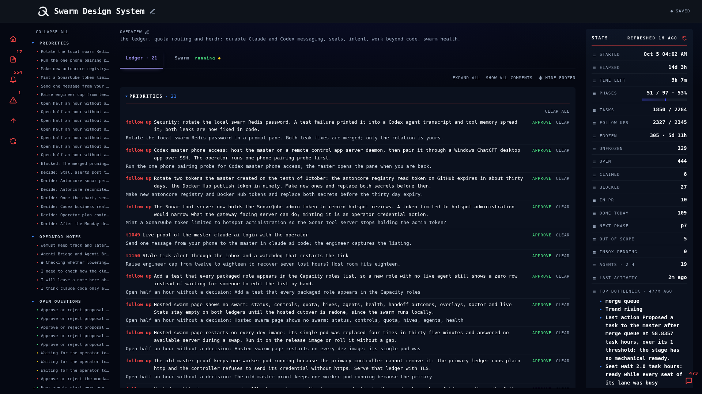
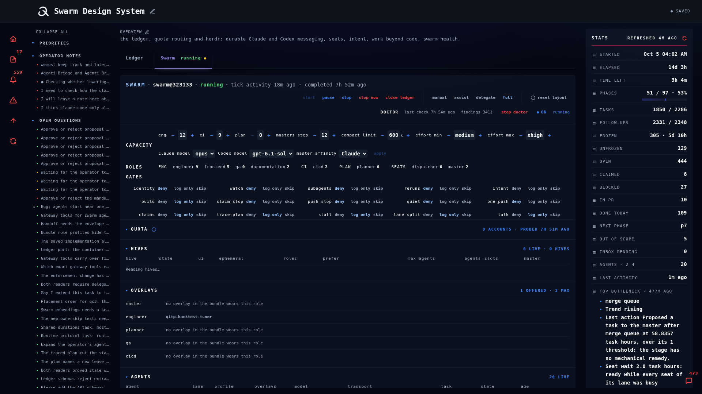

# AgentiHooks

[](https://github.com/The-Cloud-Clockwork/agentihooks/blob/main/LICENSE)
[](https://github.com/The-Cloud-Clockwork/agentihooks/actions/workflows/test.yml)
[](https://python.org)
[](https://the-cloud-clockwork.github.io/agentihooks/)

AgentiHooks is a harness for [Claude Code](https://code.claude.com/docs) and
[Codex](https://developers.openai.com/codex). It installs lifecycle hooks, an MCP
tool server, rules, skills and settings into each agent's config home, then runs
those agents on their own or as a swarm that works a shared task ledger.

Full documentation: [the-cloud-clockwork.github.io/agentihooks](https://the-cloud-clockwork.github.io/agentihooks/)

## What it does

- **Guards every tool call.** Hooks run before and after each tool call and on
  every prompt. They block secrets written to files, credential files read into
  context, pushes and pull requests into protected branches, and repeated
  identical failures.
- **Gives each agent an identity.** A profile carries the persona, rules,
  skills, settings and MCP servers. Profiles chain, and a bundle repository
  holds your own.
- **Keeps the agent informed.** Hooks inject enforcements, broadcasts and the
  brain's memory feed into the session as it runs.
- **Routes work across your quota.** Each launch goes to the Claude or Codex
  account with room left, and a session whose quota runs out is told by fixed
  rules to hand off, wait or stop.
- **Runs a swarm.** A ledger holds the plan and its tasks. A master, planners,
  engineers and CI agents work those tasks, each in its own worktree, and close
  each one with a merged pull request.

## Quick start

Requirements: Python 3.11 or later, [uv](https://docs.astral.sh/uv/), and Claude
Code or Codex. A swarm also needs Docker with the Compose plugin and
[herdr](https://herdr.dev), the terminal runtime the swarm
opens its agent panes in.

### 1. Install the harness

```bash
git clone https://github.com/The-Cloud-Clockwork/agentihooks
cd agentihooks
uv venv .venv
uv pip install --python .venv/bin/python -e ".[all]"

.venv/bin/agentihooks init                  # Claude Code, ~/.claude
.venv/bin/agentihooks init --target codex   # Codex, ~/.codex
```

`init` writes the hook wiring and settings in the target's own format, links the
skills, rules, agents and commands of the chosen profile chain that the target
supports, writes the
persona (`CLAUDE.md` for Claude Code, `AGENTS.md` for Codex), registers the
`agentihooks` MCP server and installs the `agentihooks` command with `uv tool`.
It also adds an `agenti` alias to `~/.bashrc`. Running it again is safe.

### 2. Start the local swarm stack with Docker Compose

```bash
agentihooks swarm init my-swarm --plan ~/plans/my-plan.md --repo ~/dev/my-repo \
  --operator-asked "start a swarm for my plan"
```

This copies the Compose files packaged with AgentiHooks into
`~/.agentihooks/swarm-stack` and starts three services:

| Service | What it does |
|---|---|
| `redis` | Swarm state, claims, leases and the inbox, behind a generated password |
| `swarm` | The ledger server and its web page |
| `controller` | Holds the swarm lease and reconciles every swarm each minute |

The first run writes `.env` there with a random Redis password, free ledger and
Redis ports and the released swarm image. Later runs keep them, so running it
again keeps your data. When every service is healthy and the ledger page
answers, it creates the swarm `my-swarm` and its ledger, paused, and prints the
ledger address and the next steps:

```bash
set -a; . ~/.agentihooks/swarm-stack/client.env; set +a   # point this shell at the stack
agentihooks swarm my-swarm start                            # run it
```

`swarm init` never starts a swarm by itself. A missing Docker, daemon or
Compose plugin, or an unhealthy service, is named with its fix. Details:
[Docker Compose quick start](docs/getting-started/compose-quick-start.md).

## What ships

### Hooks and guardrails

Every Claude Code and Codex lifecycle event calls `python -m hooks`. The guards
include:

| Guard | Behavior |
|---|---|
| Secrets | Blocks Write, Edit and file redirects that contain a secret; scans prompts and inline commands |
| Credential files | Blocks reads of `.env` files, shell rc files and credential stores, and names a leak free alternative |
| Branch and PR guard | Agents never open or merge pull requests into `main`, `master` or `v1` |
| Production lockdown | Only CI creates releases and merges promotion pull requests |
| Retry breaker | Directs research after 5 identical failures, blocks at 10 |
| Kubernetes mutation guard | Blocks live behavior changes such as `kubectl edit`, `patch` and `set`, and Helm upgrades outside CI |
| Dependency banner | Prints a banner on every package install |
| Version guard | Blocks agent edits to version fields |

Operator controls sit beside the guards: **enforcements** re-inject a rule every
N tool calls, **broadcasts** reach every live session or one channel, and
**conditions** are your own scripts that run on the tool calls their filename
matches and can add context, rewrite input or deny the call. The `agentihooks`
MCP server exposes channel, enforcement, condition and timer tools to the agent.

Docs: [Guardrails](https://the-cloud-clockwork.github.io/agentihooks/docs/pillars/guardrails/),
[Fleet Command](https://the-cloud-clockwork.github.io/agentihooks/docs/pillars/fleet-command/),
[Conditions](https://the-cloud-clockwork.github.io/agentihooks/docs/hooks/conditions/).

### Profiles and bundles

A profile is a folder: a `CLAUDE.md` persona plus `.claude/` rules, skills,
agents, commands, settings overrides and MCP servers, and optional `.codex/`
settings in Codex's own TOML format. Profiles chain with commas
(`agentihooks init --profile base,ops`); rules and skills accumulate and
settings deep merge. Content is written once and projected into each target.

A bundle is your own git repository of profiles, linked with
`agentihooks bundle link <path>`. AgentiHooks ships a `default` profile and the
swarm role profiles; your bundle adds the rest, and overlays add domain experts
to a base role.

Docs: [Identity](https://the-cloud-clockwork.github.io/agentihooks/docs/pillars/identity/),
[Bundles](https://the-cloud-clockwork.github.io/agentihooks/docs/bundles/),
[Overlays](https://the-cloud-clockwork.github.io/agentihooks/docs/overlays/).

### The brain

The brain is shared memory that outlives a session. It runs as its own service,
[agentibrain-kernel](https://github.com/The-Cloud-Clockwork/agentibrain-kernel).
AgentiHooks is its client: at session start and every 20 tool calls it reads
the brain's feed of hot arcs, recent lessons and active signals and injects it
into the session, and at Stop it posts the lesson, decision, milestone and
signal markers the agent wrote. It finds the brain through `BRAIN_URL`, read from
`~/.agentibrain/.env` when the brain is installed. Without a brain the hooks
skip this step.

Docs: [Context Intelligence](https://the-cloud-clockwork.github.io/agentihooks/docs/pillars/context/).

### The ledger

The ledger is one plan as a live web page served by the ledger server
(port 8765 by default). It holds the overview, phases, tasks with their pull
requests and proofs, follow ups, open questions, priorities waiting on you,
artifacts and a chat with the master. Agents read and write it with
`agentihooks ledger`, and every operator write on the page reaches the agent it
concerns as an inbox message.

The page has a Ledger tab for the plan and its tasks and a Swarm tab for the
agents, quota, capacity and health findings.





### The swarm and its roles

A swarm is a crew of Claude Code and Codex agents working one ledger. The
minute tick spawns agents up to each lane's cap, gives each claimed task a work
folder, nudges silent agents and retires idle ones. Each agent runs one task in
its own git worktree and herdr pane.

| Role | Work |
|---|---|
| Master | The one agent you talk to. Keeps the ledger, turns requests into tasks, troubleshoots read only. Never edits code. |
| Planner | Slices a phase into pull request sized tasks with their seams, territory and proof contract. |
| Dispatcher | Settles what the tick could not: ranking, grouping, the lane split and stale priorities. |
| Engineer | Works one code task end to end and closes it with one merged pull request. |
| CI engineer | Owns red pipelines and CI speed, one change per task. |
| QA | Reads proofs, gate, mutation and smoke results against their contracts. Never edits. |
| Documentation | Documents a delivered feature against the code and runs the docs build. |

Agents talk through a durable inbox, hand their work to a successor when their
context fills, and the swarm snapshots its state so it can be restored after a
reboot.

Docs: [Swarm](https://the-cloud-clockwork.github.io/agentihooks/docs/pillars/swarm/).

### Quota routing

Each Claude subscription is one `AH_CC_TOKEN_<name>` variable and each Codex
subscription one `AH_CX_TOKEN_<name>`. `agenti` (alias of `agentihooks claude`)
and `agentihooks codex` read each account's quota windows and place the
session on the account with room and the fewest live sessions.
`agentihooks balance` and `agentihooks quota` show where each account stands.
While a session runs, the quota policy tells it by fixed rules to hand its work
to a new session on another account, wait for the five hour reset, or stop.
The swarm places its agents by the same rules.

Docs: [Account load balancing](https://the-cloud-clockwork.github.io/agentihooks/docs/pillars/load-balancing/).

## Standalone or as a swarm

**Standalone.** Install with `agentihooks init` and launch Claude Code with
`agenti` or Codex with `agentihooks codex`. Each session gets the hooks,
guards, profile, brain feed and quota routing. No ledger, Redis or Docker is
needed.

**As a swarm.** Run `agentihooks swarm init <name>` to start the stack and
create a paused swarm on a repository, then start it. The master takes your
requests in its pane or on the ledger page chat, and the tick staffs the
tasks. You steer it with `agentihooks swarm <id> start|pause|stop` and `set`
for the lane caps, or the same controls on the Swarm tab.

## Where it runs

### One machine

A developer, hobbyist or professional runs everything on one machine: the
Compose stack for the ledger, Redis and controller, and the agents in herdr
panes on the same host. Credentials come from any mix of:

- **Subscriptions.** One or many Claude and Codex accounts, each as an
  `AH_CC_TOKEN_<name>` or `AH_CX_TOKEN_<name>` variable, loaded from OpenBao or
  from a private `~/.agentihooks/accounts/claude.env` or `codex.env` file.
  Routing spreads sessions across them by quota left.
- **A direct API key.** `ANTHROPIC_API_KEY` for Claude Code, `OPENAI_API_KEY` or
  `CODEX_API_KEY` for Codex. The router treats it as an api slot with no quota
  windows, limited only by an optional session cap.
- **An AI gateway.** `ANTHROPIC_BASE_URL` pointing at a host other than
  `api.anthropic.com` with its token, or `OPENAI_BASE_URL` for Codex. The router
  labels it `gateway`. A weight setting decides what share of sessions goes to
  the api side; at weight 0 it takes the overflow once every subscription is
  full.

### Several machines

A small company adds machines to one stack as hives. On the UI hive,
`agentihooks hive add <ssh target> --label <name> --url <hive endpoint>` saves
the machine in herdr with `herdr machine add` and delivers its member
credentials over SSH; headless hives add none. On each member,
`agentihooks hive install` runs the hive service, which reports the machine's
accounts and repositories and opens the agents the controller places on it.

### Kubernetes

Enterprises run the swarm in distributed mode with the Helm chart in
`deploy/helm/agentihooks-swarm`: the ledger, Redis and the lease holding
controller as cluster services, engineer and CI agents as worker Pods sized by
an approved Pod policy, and secrets through External Secrets. The master and
planning seats stay on workstation hives. Private bundles reach workers through
a bundle image, never the worker image.

Docs: [Deployed host capacity](https://the-cloud-clockwork.github.io/agentihooks/docs/pillars/swarm/#deployed-host-capacity).

## Configuration

Settings live in `~/.agentihooks/.env` and the profile chain; every feature flag
is an environment variable. See the
[Configuration reference](https://the-cloud-clockwork.github.io/agentihooks/docs/reference/configuration/)
and the [CLI reference](https://the-cloud-clockwork.github.io/agentihooks/docs/reference/cli-commands/).

## License

MIT. See [LICENSE](LICENSE).
